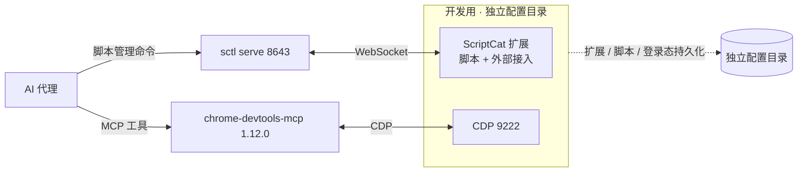

# scriptcat-dev-env-skill

[](LICENSE)

一个 [Agent Skill](https://agentskills.io/)：让 AI 代理在 Windows 上搭建、重建并排查「用[脚本猫 ScriptCat](https://docs.scriptcat.org/) 开发和调试油猴脚本」的完整环境。

> **项目概览**：仓库提供 `SKILL.md`、部署与架构文档、启动器与自检脚本、配置模板，不含本机路径或凭据。快速开始：`npx skills add HANJP98/scriptcat-dev-env-skill -g -a codebuddy -y`，新开会话后让 AI 代理重建环境。前置条件：Windows 10/11、Edge Chromium 136+、Node.js 20.19+/22.12+、支持 MCP 与 Agent Skills 的 AI 宿主。MIT 许可。

---

## 这是什么

油猴脚本的开发成本主要在验证闭环：每次改动都要重新安装脚本、打开目标页面、查看控制台和网络请求，再改下一版。这个仓库把闭环所需的环境固化成一份可供 AI 代理阅读和执行的说明，以及一组可直接使用的脚本与配置模板。

它包含：

- `SKILL.md`：AI 代理的入口文件，写清部署步骤、分工、验收标准、已知失败原因与红线。
- `docs/`：完整部署指南、组件架构、MCP 参数速查、排障速查表。
- `scripts/`：浏览器启动器、快捷方式生成、只读自检、MCP 端到端探测。
- `config/`：MCP 服务配置模板与锁定版本的依赖清单。

AI 代理读取 `SKILL.md` 后，可自行完成环境探查、安装依赖、写配置、生成启动器、注册服务、启动浏览器和验收；涉及账号、登录态与授权的步骤仍由使用者完成。

### 适用与不适用范围

| 场景 | 是否适用 |
| --- | --- |
| 首次搭建、换机重建、重装后恢复这套环境 | 适用 |
| 某条链路失效（调试端口连不上、外部接入掉线、MCP 工具组消失） | 适用 |
| 判断某个操作该走哪条工具链 | 适用 |
| 只想写一个 `.user.js`，不需要部署环境 | 不适用，用官方 `scriptcat-userscript` skill |
| macOS / Linux | 不适用，脚本与结论基于 Windows 实测 |

## 组件分工

| 组件 | 所在浏览器配置 | 通道 | 职责 |
| --- | --- | --- | --- |
| `chrome-devtools-mcp` 1.12.0 | 独立开发配置目录 | CDP `9222` | DOM、控制台、网络请求、截图、执行 JS、性能分析 |
| `sctl` + ScriptCat 外部接入 | 同一开发配置目录 | WebSocket `8643` | 列出、读取、安装、编辑、启停、删除脚本 |
| 官方 skill `scriptcat-userscript`、`sctl` | 用户级 skills 目录 | 本地文件 | 脚本写法规则、骨架与静态检查、sctl 命令用法 |

两条通道可同时运行，同一任务内不要混用。开发配置目录独立保存扩展、脚本与登录态，与日常上网互不干扰。

**不安装 `sctl Browser` 扩展**：它的页面调试能力通过 `chrome.debugger` 附着标签页，与 CDP MCP 争用同一目标；CDP MCP 已覆盖这部分能力。ScriptCat 外部接入只走扩展消息，不占用调试器，因此与 `9222` 不冲突。



## 快速开始

### 方式 A：安装为 skill（推荐）

把仓库放进宿主的 skills 目录，之后直接对 AI 代理说「重建油猴脚本开发环境」。

```powershell
git clone https://github.com/HANJP98/scriptcat-dev-env-skill.git "$env:USERPROFILE\.codebuddy\skills\scriptcat-dev-env-skill"

# 宿主读取 ~/.workbuddy/skills/ 时，用目录联接保持单一副本
New-Item -ItemType Junction `
  -Path "$env:USERPROFILE\.workbuddy\skills\scriptcat-dev-env-skill" `
  -Target "$env:USERPROFILE\.codebuddy\skills\scriptcat-dev-env-skill"
```

若宿主直接读取 `~/.workbuddy/skills/`，克隆到该目录即可，无需目录联接。也可以使用官方安装器（宿主在支持列表内时）：

```bash
npx skills add HANJP98/scriptcat-dev-env-skill -g -a codebuddy -y
```

> 新安装的 skill 在当次会话不会加载，请开一个新会话再开始写脚本。

### 方式 B：手动部署

按 [`docs/deployment-guide.md`](docs/deployment-guide.md) 逐步执行。`scripts/` 下的文件可直接使用，`config/` 中的占位符需替换为本机实际探测值。

### 方式 C：换机或重装

克隆本仓库 → 在新会话中让 AI 代理读取 `SKILL.md` → 它会执行所有可由脚本和命令完成的步骤，并把需要账号或授权的操作一次性列出。

## 前置条件

| 组件 | 要求 |
| --- | --- |
| 操作系统 | Windows 10 / 11 |
| 浏览器 | Microsoft Edge（Chromium 136+；136 起默认配置目录会忽略调试端口，因此必须使用独立配置目录） |
| Node.js | ≥ 20.19、≥ 22.12 或 ≥ 23（21.x 不受 `chrome-devtools-mcp` 支持） |
| AI 宿主 | WorkBuddy / CodeBuddy，或任何支持 MCP 与 Agent Skills 的客户端 |
| 扩展 | ScriptCat，装在开发用的独立配置目录中 |
| 命令行 | `sctl`（安装脚本会一并安装） |

## 需要手动完成的步骤

以下操作涉及账号、登录态或授权，AI 代理无法代做。部署时会被一次性列出：

1. 在连接器管理页对 `chrome-devtools` 点「信任」，必要时重启宿主。
2. 在开发用的浏览器窗口中安装 ScriptCat 等扩展、登录目标网站、选择外部接入权限策略。
3. 在终端执行 `sctl connect`，把一次性配对码输入该窗口的 ScriptCat。

配对码只在终端显示一次、有效期约 2 分钟，不应写入对话或日志。日常浏览器中的 ScriptCat 不要重复接入同一个 `sctl` 服务，否则写操作可能落到另一套脚本上。

## 验收与排障

`scripts/doctor.ps1` 是只读自检，检查配置、Node、MCP 参数、端口与配置目录；`scripts/probe-mcp.mjs` 直接通过 stdio JSON-RPC 验证 MCP 握手与 `list_pages`。两者都不会启动或结束浏览器进程。

常见问题（调试端口不生效、AI 启动的浏览器进程被回收、MCP 工具组消失、外部接入状态异常）及实测结论见 [`docs/troubleshooting.md`](docs/troubleshooting.md)，CLI 参数含义见 [`docs/mcp-parameters.md`](docs/mcp-parameters.md)。

## 目录

```
├── SKILL.md                            # Agent Skill 入口：步骤、分工、验收、红线
├── docs/
│   ├── deployment-guide.md             # 完整部署指南（命令与解释）
│   ├── architecture.md                 # 组件分工与选型理由
│   ├── mcp-parameters.md               # chrome-devtools-mcp 1.12.0 参数速查
│   └── troubleshooting.md              # 排障速查表
├── scripts/
│   ├── start-agent-edge.bat            # 启动独立配置目录与 9222（幂等）
│   ├── make-shortcut.ps1               # 生成桌面版与 AI 版快捷方式
│   ├── start-agent-edge-detached.ps1   # 由系统 shell 代启浏览器
│   ├── doctor.ps1                      # 只读自检
│   └── probe-mcp.mjs                   # stdio JSON-RPC 端到端探测
├── config/
│   ├── mcp.json.example                # MCP 服务配置模板（含占位符）
│   ├── package.json                    # 锁定 chrome-devtools-mcp@1.12.0
│   └── package-lock.json
├── LICENSE                             # MIT
└── .gitignore
```

## 安全与隐私

- 仓库中的路径均使用 `%USERPROFILE%` 或 `<...>` 占位符，不含真实用户名、绝对路径、Cookie、访问令牌、配对码或用户脚本源码。
- 开发配置目录保存登录态与 Cookie，不要提交到版本库，也不要跨机器复制。
- ScriptCat 外部接入的「写操作 / 源码读取」权限策略默认为「需人工审批」。改为「直接允许」意味着外部程序可读取源码并修改脚本，请按自己的使用环境权衡。
- 自检与探测脚本只读；实际改动由 AI 代理按 `SKILL.md` 的步骤执行。

## 版本基线

结论实测于 Microsoft Edge 157.0.4341.42、Node.js 22.22.2、chrome-devtools-mcp 1.12.0、sctl 0.3.0、ScriptCat 1.5.0（2026-11-07）。组件升级后请重新核对参数名与版本门槛，尤其是 `chrome-devtools-mcp` 的命令行参数。

## 反馈与贡献

遇到问题请提交 [Issue](https://github.com/HANJP98/scriptcat-dev-env-skill/issues)；如果在其他版本组合上实测到差异，欢迎通过 Pull Request 更新 `docs/` 中的结论。

## 相关项目

- [ScriptCat（脚本猫）](https://docs.scriptcat.org/) — 用户脚本运行器
- [sctl](https://github.com/scriptscat/sctl) — 命令行工具与 AI 外部接入
- [chrome-devtools-mcp](https://github.com/ChromeDevTools/chrome-devtools-mcp) — 页面调试 MCP 服务
- 官方 skills：`scriptscat/scriptcat`、`scriptscat/sctl`（脚本写法规则与 sctl 用法，本仓库不重复）

## License

[MIT](LICENSE)
