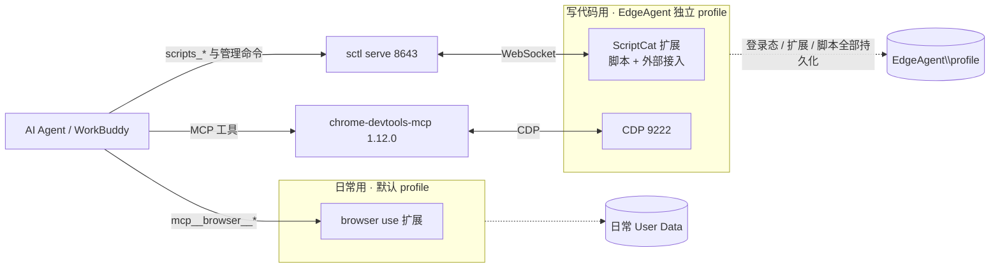

# scriptcat-dev-env-skill

> 一个 Agent Skill：让 AI 在 Windows 上自动搭建、重建和排查「用脚本猫开发 / 调试油猴脚本」的完整环境。

[](LICENSE)

**English**: An [Agent Skill](https://agentskills.io/) that teaches an AI agent how to build, rebuild and troubleshoot a Windows userscript development environment on top of [ScriptCat](https://docs.scriptcat.org/): a dedicated Edge profile driven by `chrome-devtools-mcp` (CDP 9222), ScriptCat's External Access via `sctl` (WebSocket 8643), the two official ScriptCat skills, and WorkBuddy browser use for the everyday profile. All scripts, config templates and hard-won troubleshooting notes are included and free of machine-specific values.

---

## 它解决什么问题

写油猴脚本最烦的不是写代码，是**验证闭环**：改一版 → 装进浏览器 → 打开目标页 → 看 console / 网络请求 → 再改一版。人工做要反复切窗口、点扩展、刷新页面。

这套环境把闭环拆成互不冲突的通道，让 AI 全程代办：

- **脚本本身**交给 `sctl` + ScriptCat「外部接入」（列出 / 读源码 / 安装 / 编辑 / 启停 / 删除）
- **页面效果**交给 `chrome-devtools-mcp`（DOM / console / network / 截图 / 执行 JS / 性能 trace）
- **日常上网**仍在自己的浏览器，用 WorkBuddy browser use，登录态互不干扰

而且它把「换台机器要不要重新踩一遍坑」这个问题解决了：**所有踩过的坑都写进了 `SKILL.md`**，AI 读一遍就知道哪些方案行不通、`workbuddy` 不是合法 agent 名、`426 Upgrade Required` 其实是正常的、AI 会话里直接启动的浏览器为什么下一条命令就消失。

> **本仓库是这套环境唯一维护的文档源。** 不在别处另存部署说明或脚本备份；换机、重装、排障、版本订正都改这里。实机运行副本只放在 `%USERPROFILE%\EdgeAgent\`，改了模板同步过去即可。含真实账号、路径、信任指纹、脚本名的本机实况不写进公开仓库。

## 架构



**为什么不装 `sctl Browser` 扩展**：它的 `page` / `debug` / `cdp` 用 `chrome.debugger` 附着标签页，与 CDP MCP 抢同一 target；CDP MCP 已覆盖并超过它的页面侧能力。不装就没有调试器冲突和「正在调试」信息栏。ScriptCat 外部接入只走扩展消息，不 attach debugger。

## 快速开始

### 方式 A：装成 skill（推荐）

把本仓库放进宿主的 skills 目录，之后直接对 AI 说「重建油猴脚本开发环境」即可。

```powershell
git clone https://github.com/HANJP98/scriptcat-dev-env-skill.git "$env:USERPROFILE\.codebuddy\skills\scriptcat-dev-env-skill"
# WorkBuddy 读 ~/.workbuddy/skills/ 时，建一个目录联接保持单一数据源：
New-Item -ItemType Junction `
  -Path "$env:USERPROFILE\.workbuddy\skills\scriptcat-dev-env-skill" `
  -Target "$env:USERPROFILE\.codebuddy\skills\scriptcat-dev-env-skill"
```

> 若宿主直接读 `~/.workbuddy/skills/`，clone 到那里即可，无需 Junction。
> **新装 skill 当次会话不会加载，请开一个新会话再让它写脚本。**

也可以用官方安装器（如果宿主在支持列表里）：

```bash
npx skills add HANJP98/scriptcat-dev-env-skill -g -a codebuddy -y
```

### 方式 B：手动部署

按 [`docs/deployment-guide.md`](docs/deployment-guide.md) 逐步执行；`scripts/` 下是可直接用的启动器、自检器和端到端探测脚本，`config/` 是配置模板。

### 方式 C：换机 / 重装

`git clone` 本仓库 → 在新会话里让 AI 读 `SKILL.md` → 它会按 15 步 SOP 自己跑完 11 步，把剩下必须本人操作的 4 步一次性列给你。

## 前置条件

| 组件 | 要求 |
| --- | --- |
| OS | Windows 10 / 11 |
| 浏览器 | Microsoft Edge（Chromium **136+**，因为 136+ 对默认 profile 忽略调试端口） |
| Node.js | ≥ 20.19 / ≥ 22.12 / ≥ 23（**21.x 不受支持**） |
| 宿主 | WorkBuddy / CodeBuddy 或任何支持 MCP + Agent Skills 的 AI 客户端 |
| 扩展 | ScriptCat（装在**开发 profile** 里） |
| 命令 | `sctl`（安装脚本会自动装） |

## 必须由本人完成的 4 件事

AI 会跑完其余全部步骤。这四件涉及账号、登录态与授权，必须本人操作：

1. 连接器管理页对 `chrome-devtools` 点「信任」，必要时重启宿主
2. 在 **EdgeAgent 窗口**装 ScriptCat / 需要的扩展、登录目标网站、选择外部接入权限策略
3. 终端跑 `sctl connect`，把一次性 8 位码输入**该窗口**的 ScriptCat（2 分钟有效、不进对话、不进日志）
4. 安装 WorkBuddy browser use 扩展（设置 → 智能体 → 浏览器操控）

> 日常 Edge 里的 ScriptCat **不要**也去 Enroll，否则两个实例连同一个 `sctl serve`，写操作可能落到正在用的那套脚本上。

## 目录

```
├── SKILL.md                       # ★ Agent Skill 入口：SOP、硬知识、红线、验收
├── docs/
│   ├── deployment-guide.md        # 完整部署指南（命令 + 解释）
│   ├── architecture.md            # 组件分工与选型理由
│   ├── mcp-parameters.md          # chrome-devtools-mcp 1.12.0 CLI 参数速查
│   └── troubleshooting.md         # 排障速查表
├── scripts/
│   ├── start-agent-edge.bat       # 启动独立 profile + 9222（幂等）
│   ├── make-shortcut.ps1          # 桌面版 / AI 版快捷方式
│   ├── start-agent-edge-detached.ps1  # AI 代启，脱离会话进程树
│   ├── doctor.ps1                 # 只读自检
│   └── probe-mcp.mjs              # stdio JSON-RPC 端到端探测
├── config/
│   ├── mcp.json.example           # MCP 配置模板（含占位符）
│   ├── package.json               # 锁定 chrome-devtools-mcp@1.12.0
│   └── package-lock.json
├── LICENSE                        # MIT
└── .gitignore
```

## 安全与隐私

- 仓库内**不含**任何真实用户名、本机绝对路径、Cookie、`control.token`、配对码、信任指纹或用户脚本源码；所有路径用 `%USERPROFILE%` 或 `<...>` 占位符。
- `EdgeAgent\profile` 保存登录态与 Cookie，**不要备份到公开仓库、不要跨机器复制**。
- ScriptCat 外部接入的「写操作 / 源码读取」权限策略默认是「需人工审批」；若改成「直接允许」，等于允许外部程序读源码、改脚本。请自行权衡。
- `doctor.ps1` 是只读脚本，不启动也不结束任何进程；`probe-mcp.mjs` 只做握手和 `list_pages`。

## 版本基线

结论实测于 Edge 157.0.4341.42 / Node 22.22.2 / chrome-devtools-mcp 1.12.0 / sctl 0.3.0 / ScriptCat 1.5.0 / browser use 0.2.8（2026-11-07）。
组件升级后请重新核对参数名与版本门槛，尤其是 `chrome-devtools-mcp` 的 CLI 参数。

## 相关项目

- [ScriptCat（脚本猫）](https://docs.scriptcat.org/) — 运行器
- [sctl](https://github.com/scriptscat/sctl) — 命令行 / AI 外部接入
- [chrome-devtools-mcp](https://github.com/ChromeDevTools/chrome-devtools-mcp) — 页面调试
- 官方 skills：`scriptscat/scriptcat`、`scriptscat/sctl`（写法规则与 sctl 用法，别和本 skill 重复）

## License

[MIT](LICENSE)
